

<a href="https://vikrantyadav.vercel.app/"></a>

 

<a href="https://vikrantyadav.vercel.app/"></a>
<a href="https://linkedin.com/in/vikrant-yadav"></a>
<a href="mailto:vikrant.yadav2024@nst.rishihood.edu.in"></a>

 
<a href="https://leetcode.com/u/vikgenix"></a>
<a href="https://codeforces.com/profile/vikrantyadav"></a>
<a href="https://codechef.com/users/vikrantyadav"></a>

  

 


  


  



  


  

  

<picture>
  <source media="(prefers-color-scheme: dark)" srcset="https://raw.githubusercontent.com/vikgenix/vikgenix/output/snake-dark.svg" />
  <source media="(prefers-color-scheme: light)" srcset="https://raw.githubusercontent.com/vikgenix/vikgenix/output/snake-light.svg" />
  
</picture>

 

